## Evidencia de pruebas (capturas)

Las capturas están en la carpeta `capturas/`. Cada ronda tiene una captura en ROJO
(pruebas fallando) y una en VERDE (pruebas pasando).

| Captura | Qué muestra |
|---|---|
| `00_estructura_proyecto.png` | Estructura de carpetas del proyecto |
| `R02_dinero_ROJO.png` / `R02_dinero_VERDE.png` | Ronda 2: dinero y fechas |
| `R03_monedero_ROJO.png` / `R03_monedero_VERDE.png` | Ronda 3: monedero |
| `R04_tienda_ROJO.png` / `R04_tienda_VERDE.png` | Ronda 4: tienda |
| `R05_viajes_ROJO.png` / `R05_viajes_VERDE.png` | Ronda 5: viajes |
| `R06_metricas_ROJO.png` / `R06_metricas_VERDE.png` | Ronda 6: métricas |
| `R07_chat_ROJO.png` / `R07_chat_VERDE.png` | Ronda 7: chat |
| `R08_horoscopo_ROJO.png` / `R08_horoscopo_VERDE.png` | Ronda 8: mini-app de terceros |
| `R09_retencion_ROJO.png` / `R09_retencion_VERDE.png` | Ronda 9: retención y lealtad |
| `R10_servicios_ROJO.png` / `R10_servicios_VERDE.png` | Ronda 10: servicios |
| `R11_vms_ROJO.png` / `R11_vms_VERDE.png` | Ronda 11: ViewModels |
| `R12_general_ROJO.png` / `R12_general_VERDE.png` | Ronda 12: todas las pruebas juntas |
| `13_VERDE_total_104_pruebas.png` | `flutter test`: +104 All tests passed |
| `14_app_inicio.png` a `17_app_mensajes.png` | La app corriendo |

## Evidencia de pruebas y ejecución

Capturas de la carpeta `capturas/` documentando el ciclo de pruebas (ROJO = fallo, VERDE = aprobado), el total de pruebas y la aplicación en ejecución.

### Estructura y estado general

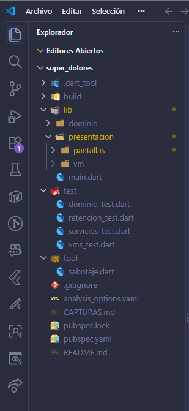

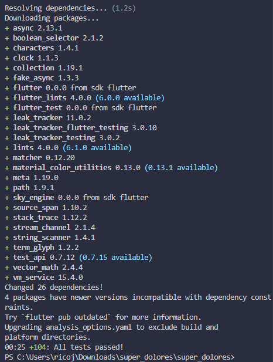

### Aplicación en ejecución

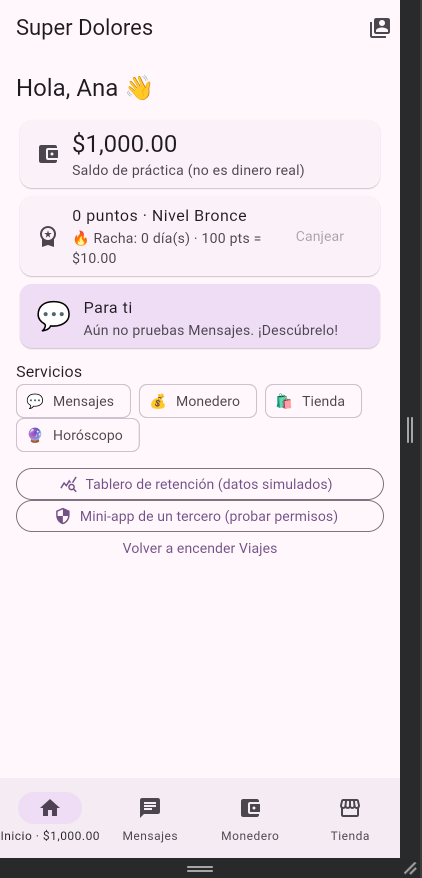

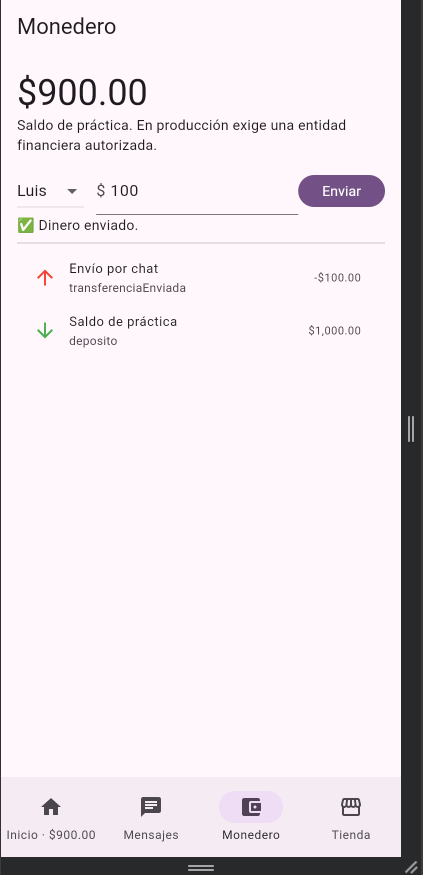

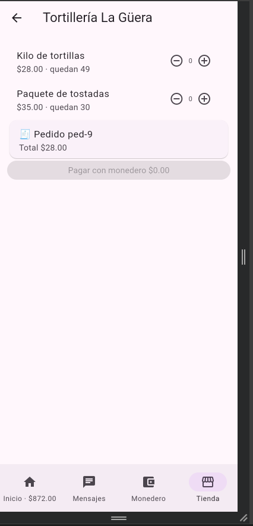

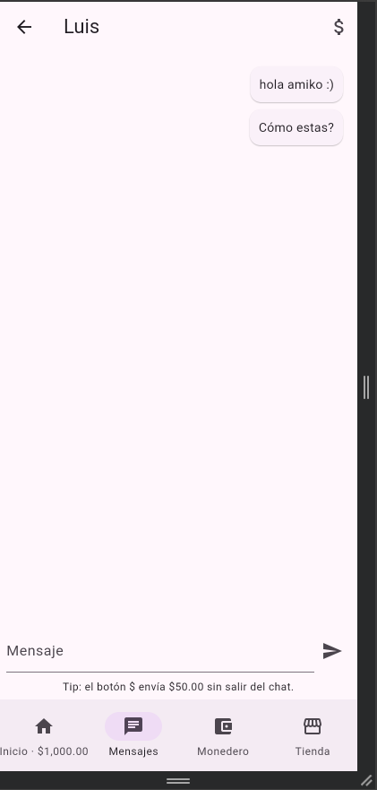

### Rondas de pruebas (ROJO / VERDE)

#### Ronda 2: Dinero y fechas
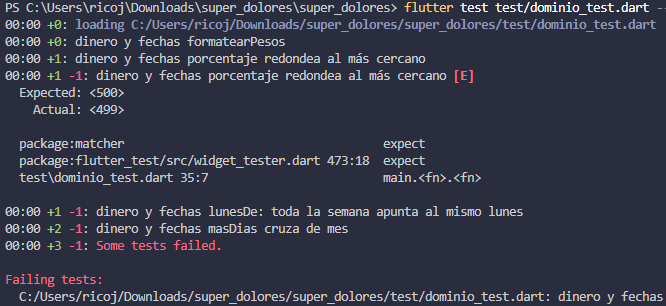
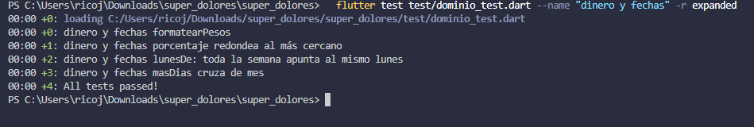

#### Ronda 3: Monedero
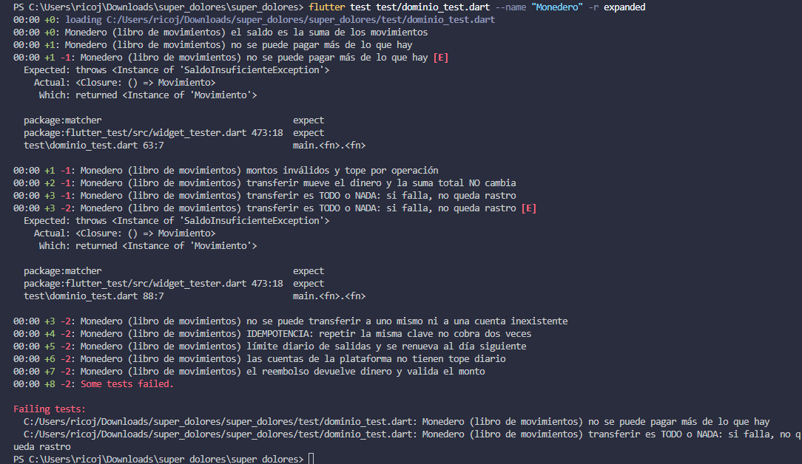
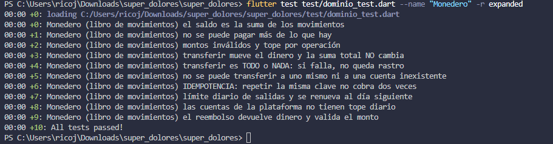

#### Ronda 4: Tienda
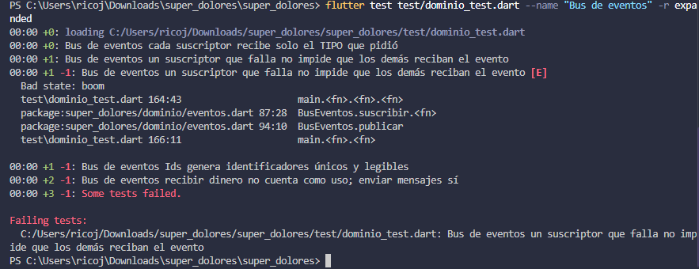
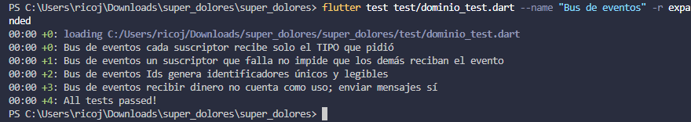

#### Ronda 5: Viajes
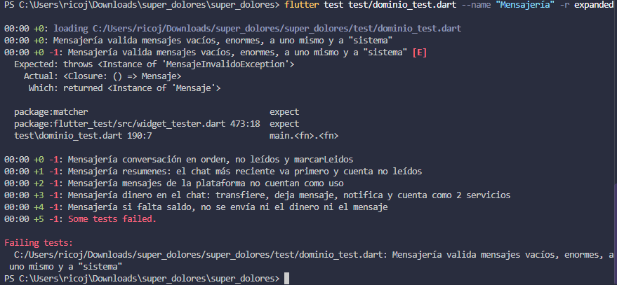
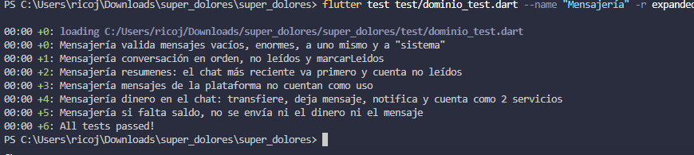

#### Ronda 6: Métricas
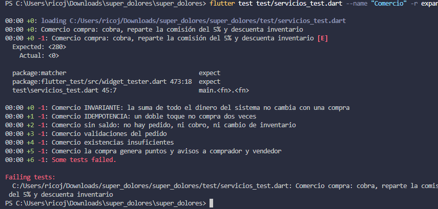
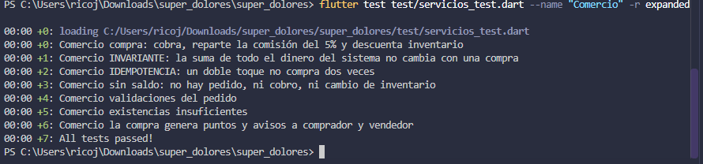

#### Ronda 7: Chat
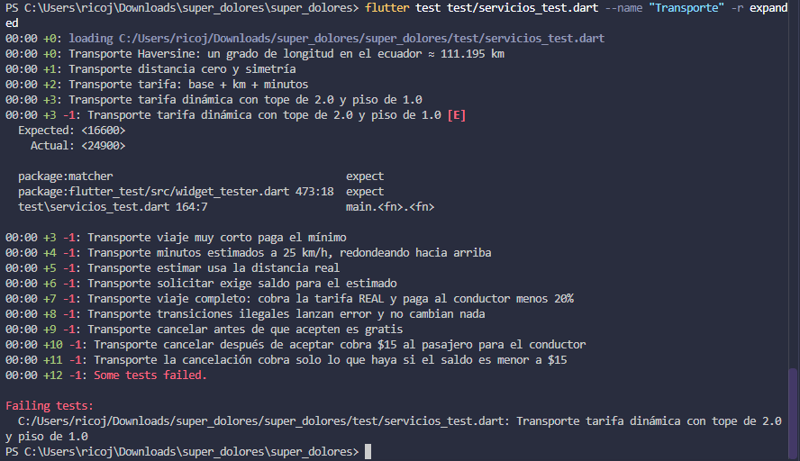
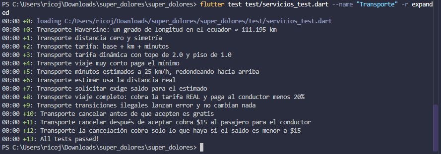

#### Ronda 8: Horóscopo
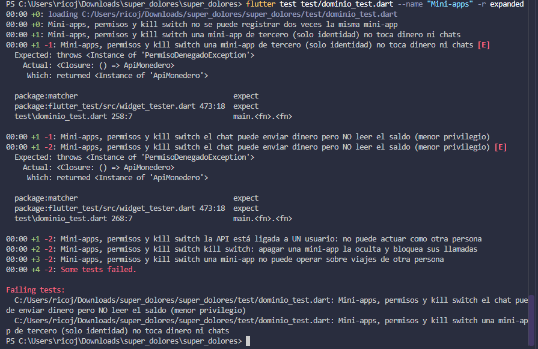
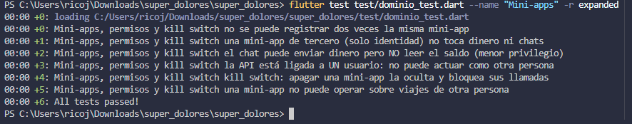

#### Ronda 9: Retención
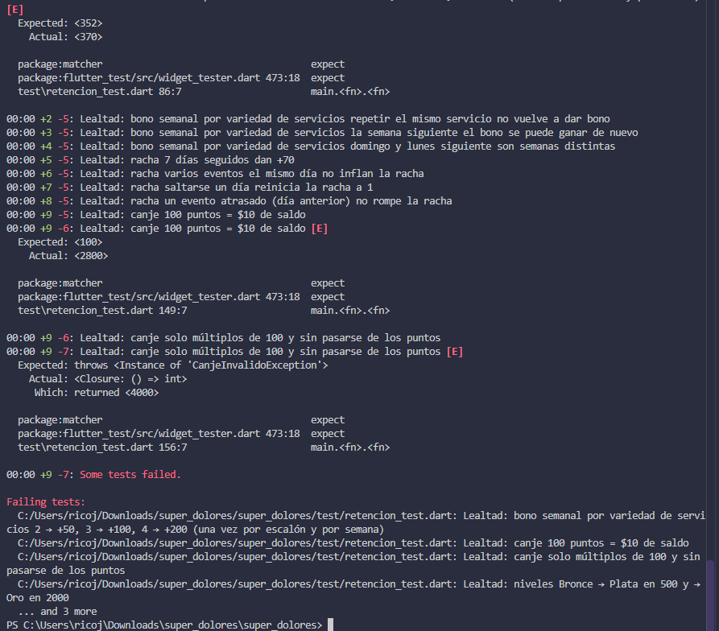
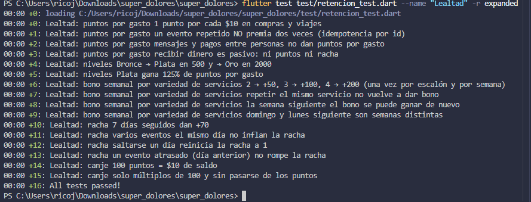

#### Ronda 10: Servicios
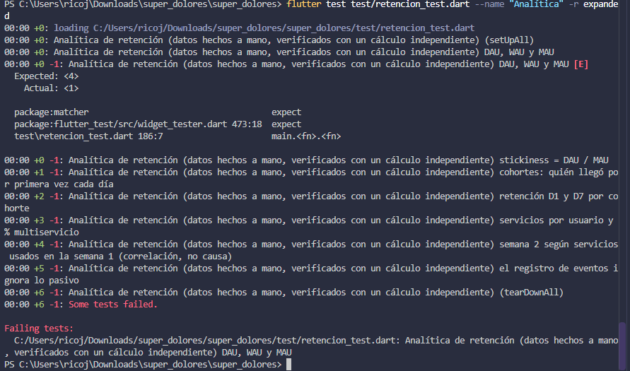
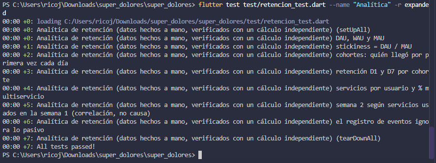

#### Ronda 11: ViewModels (VMs)
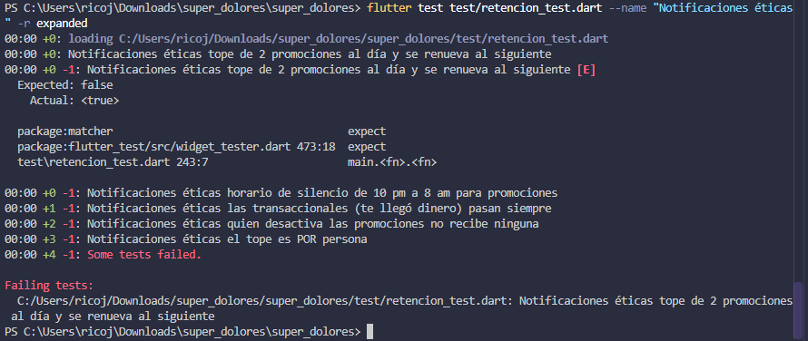
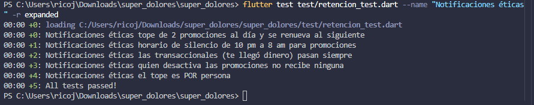

#### Ronda 12: General
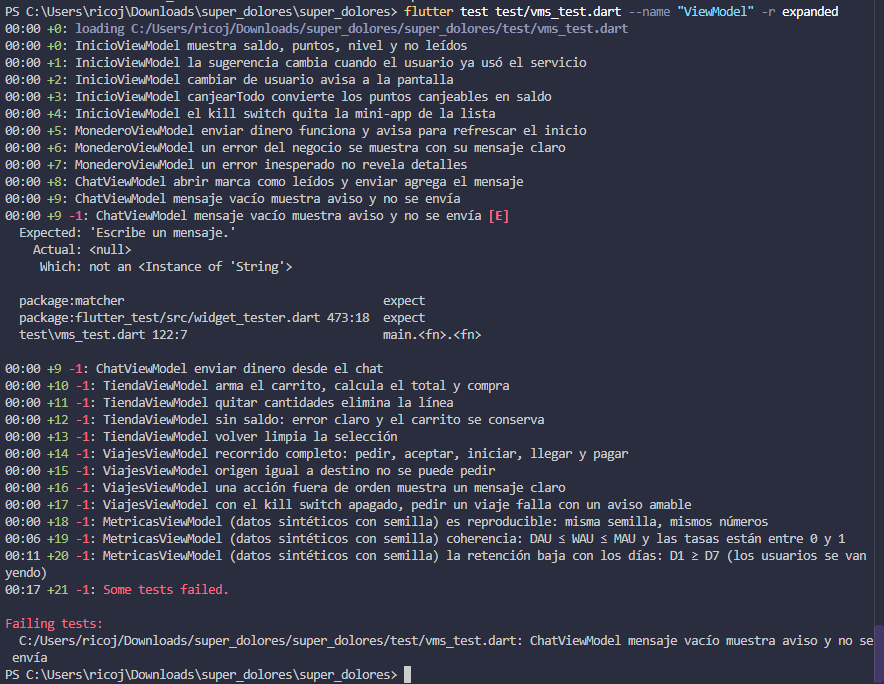
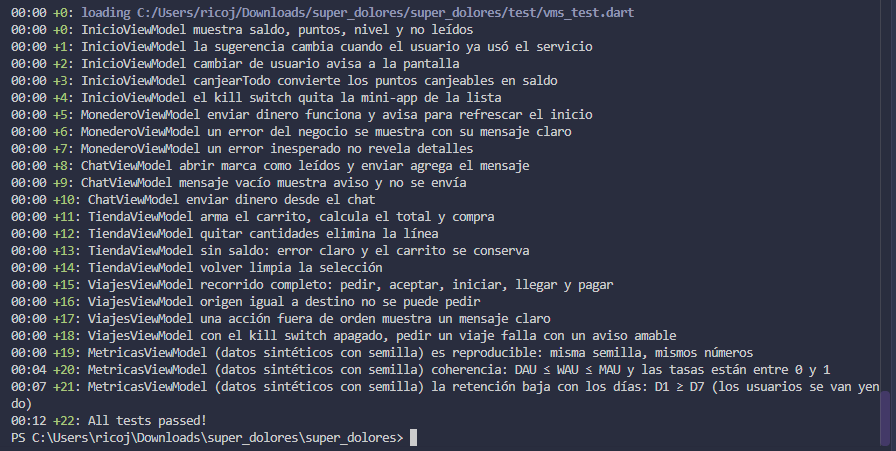